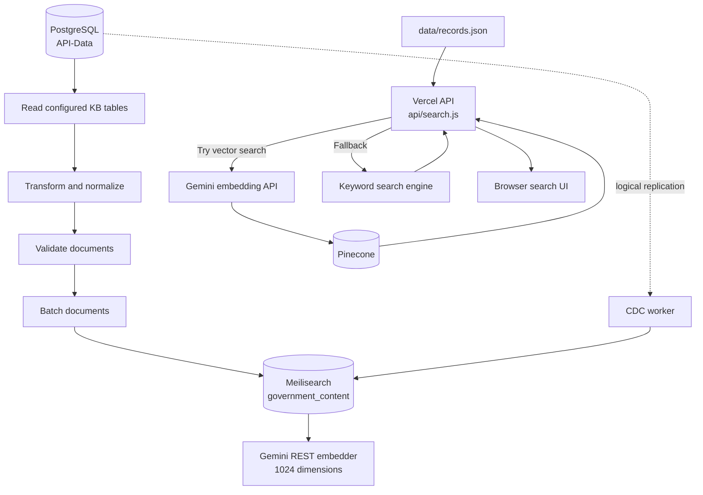

# Government of Bermuda Knowledge Base Automation

A data-ingestion and search project for the Government of Bermuda Knowledge Base. It synchronizes structured knowledge-base records from PostgreSQL into Meilisearch, supports ongoing PostgreSQL change-data capture (CDC), and includes a web search experience with autocomplete, pagination, typo-tolerant keyword matching, and an optional Gemini Embeddings + Pinecone vector-search path.

> **Important:** This repository contains two related search paths:
>
> - **Python ingestion path:** PostgreSQL → transformation and validation → Meilisearch. Meilisearch is configured with a Gemini REST embedder for 1,024-dimensional document embeddings.
> - **Web search path:** Vercel serverless API + static JSON records. The API attempts Gemini embedding + Pinecone vector search, then falls back to an in-process keyword engine if vector search is unavailable.
>
> These paths have separate configuration and data sources. The Python pipeline does not automatically publish records into `data/records.json` or Pinecone.

## Contents

- [Project goals](#project-goals)
- [Capabilities](#capabilities)
- [Architecture](#architecture)
- [Repository layout](#repository-layout)
- [Data sources and document schema](#data-sources-and-document-schema)
- [Technology stack](#technology-stack)
- [Prerequisites](#prerequisites)
- [Configuration](#configuration)
- [Quick start: Python and Meilisearch](#quick-start-python-and-meilisearch)
- [Run the full orchestrator](#run-the-full-orchestrator)
- [Full synchronization](#full-synchronization)
- [Continuous change-data capture](#continuous-change-data-capture)
- [Health checks](#health-checks)
- [Web search application](#web-search-application)
- [Search API reference](#search-api-reference)
- [Index configuration](#index-configuration)
- [Data integrity and operational notes](#data-integrity-and-operational-notes)
- [Troubleshooting](#troubleshooting)
- [Security](#security)
- [Limitations and implementation notes](#limitations-and-implementation-notes)

## Project goals

The project is designed to:

1. Read knowledge-base records from a PostgreSQL database without using the ingestion process to modify source records.
2. Normalize articles, news, pages, and services into a common document format.
3. validate documents before sending them to the search index.
4. Ingest records in batches rather than loading an entire database table into memory.
5. Configure a consistent Meilisearch index, including searchable/filterable/sortable fields and a Gemini REST embedder.
6. Keep the index up to date using PostgreSQL logical replication and a CDC worker.
7. Provide a browser-based search UI backed by a serverless API, with autocomplete and paginated results.
8. Use vector search when its external dependencies are configured, while retaining a keyword-search fallback.

## Capabilities

### Data ingestion and synchronization

- Reads the configured source tables in the PostgreSQL schema.
- Streams rows in batches using database cursors.
- Converts HTML content into normalized plain text where applicable.
- Builds a unified `search_text` field from titles, summaries, content, agency names, and topics.
- Validates required fields and topic structure before indexing.
- Uses stable document IDs derived from the source table and source record ID.
- Creates the configured Meilisearch index if it does not already exist and applies index settings.
- Waits for Meilisearch tasks and verifies the final indexed document count during a full synchronization.
- Supports a configurable list of source tables to exclude.

### Continuous synchronization (CDC)

- Consumes PostgreSQL logical-replication events using the configured replication plugin.
- Handles inserts and updates by fetching the current source row and upserting its transformed document.
- Handles deletes by removing the corresponding indexed document.
- Ignores changes from tables outside the supported knowledge-base table set.
- Logs worker failures and retries after a delay.

### Search experience

The web UI includes:

- Search form and results display.
- Autocomplete suggestions with title matching and typo tolerance.
- Result counts and previous/next pagination.
- Result title, summary, content type, agency, and destination URL where available.
- HTML escaping of displayed text in the browser UI.
- A serverless API that attempts vector search and falls back to keyword search.

## Architecture



### Main data flow

1. **Extract:** The Python database layer reads from the configured PostgreSQL schema and supported tables.
2. **Transform:** Source-specific fields are mapped into the common search-document schema. HTML bodies are converted to text where appropriate.
3. **Validate:** Documents are checked for a non-empty `id`, `title`, and `search_text`, and for `topics` being a list.
4. **Index:** Documents are upserted into Meilisearch in batches. The configured index uses `id` as its primary key.
5. **Keep current:** The CDC worker consumes logical-replication events, re-reads the current source row for inserts/updates, and updates or deletes the matching indexed document.
6. **Serve web search:** The browser calls `/api/search`. The API tries vector search using Gemini and Pinecone, and falls back to a keyword engine over `data/records.json` if vector search fails or is not configured.

## Repository layout

```text
.
├── api/
│   └── search.js                  # Vercel serverless search API
├── config/
│   └── settings.py               # Environment-backed application settings
├── data/
│   └── records.json              # Static JSON dataset used by the web API
├── docker/
│   ├── compose.yaml              # PostgreSQL and Meilisearch service definitions
│   └── postgres/
│       └── Dockerfile
├── ingestion/
│   ├── cdc.py                    # PostgreSQL logical-replication consumer
│   ├── data_pipeline.py          # Full extraction/transform/validate/index pipeline
│   ├── database.py               # PostgreSQL read and row-access layer
│   ├── db_inspector.py           # Database/table inspection helpers
│   ├── docker_manager.py         # Docker and Meilisearch startup automation
│   ├── env_checker.py            # Environment validation
│   ├── extract.py                # Typed extraction helpers
│   ├── index_setup.py            # Meilisearch index setup
│   ├── meilisearch_client.py     # Meilisearch operations and task handling
│   ├── sync.py                   # Full synchronization with count verification
│   ├── tester.py                 # Search verification helpers
│   ├── transform.py              # Source-to-document transformation
│   └── validate.py               # Document validation
├── meili_config/
│   └── index_config.py           # Search and embedder settings
├── scripts/
│   ├── cdc.py                    # CDC worker entry point
│   ├── health_check.py           # PostgreSQL and Meilisearch checks
│   └── sync.py                   # Synchronization CLI
├── ui/
│   ├── index.html                # Deployed web UI entry point
│   ├── app.js                    # API-backed browser UI
│   ├── local.html                # Local/static UI entry point
│   ├── local.js                  # Local UI script
│   └── styles.css                # UI styles
├── orchestrator.py               # End-to-end local workflow
├── requirements.txt              # Python dependencies
├── package.json                  # Node.js package metadata
├── vercel.json                   # Vercel routing and asset configuration
├── .env.example                  # Environment-variable template
└── README.md
```

## Data sources and document schema

### Supported PostgreSQL tables

By default, the Python ingestion layer supports these tables in `KB_SCHEMA` (default: `public`):

| Source table | Content type | Content handling |
|---|---|---|
| `articles_kb` | `articles` | `summary` plus HTML `body_html` converted to text |
| `news_kb` | `news` | `summary` plus HTML `body_html` converted to text |
| `pages_kb` | `pages` | `content` normalized as text |
| `services_kb` | `services` | `description` plus HTML `body_html` converted to text |

The exact column availability is determined by the source database schema. The transform expects an `id` and maps optional fields such as `title`, `slug`, `agency_name`, `topics`, `published_at`, `url`, and `form_url`.

### Unified indexed document

The transformation layer produces documents with the following fields:

| Field | Purpose |
|---|---|
| `id` | Composite source identity, formatted as `<table>:<source-id>` before Meilisearch-safe normalization |
| `source_id` | Original source record ID as a string |
| `source_table` | Originating PostgreSQL table |
| `content_type` | Source table name without the `_kb` suffix |
| `slug` | Content slug, when available |
| `title` | Main title; required by validation |
| `summary` | Summary or description text |
| `content` | Normalized searchable body text |
| `agency_name` | Related agency or department |
| `published_at` | ISO-formatted publication timestamp, when present |
| `url` | Public destination URL, when present |
| `form_url` | Related form URL, when present |
| `topics` | List of topic strings |
| `search_text` | Consolidated text used for search and the Meilisearch embedder template |

Legacy source `embedding` values are deliberately excluded by the database normalization layer; the Python Meilisearch configuration is intended to generate embeddings through its configured REST embedder.

## Technology stack

- **Python** for extraction, transformation, validation, synchronization, CDC, and operational scripts.
- **PostgreSQL** as the source of truth.
- **Meilisearch** as the Python ingestion path's search index.
- **Gemini Embeddings (`gemini-embedding-001`)** for Meilisearch's configured REST embedder and for web API query embeddings.
- **Pinecone** as the vector store used by the web API's optional vector-search path.
- **Node.js 20 or later** for the JavaScript serverless API.
- **Vanilla HTML, CSS, and JavaScript** for the web interface.
- **Docker Compose** for local service orchestration.
- **Vercel** for the web UI and serverless API deployment.

## Prerequisites

For the Python ingestion workflow:

- Python 3.11+ recommended (use a Python version compatible with the installed dependencies).
- PostgreSQL reachable from the machine running the scripts.
- Docker Engine/Desktop if using the provided Meilisearch service automation.
- A Meilisearch instance and master key.
- A Gemini API key for the configured Meilisearch REST embedder.
- Database credentials with read access to the knowledge-base tables. For CDC, the database role also needs the relevant logical-replication permissions.

For the web application:

- Node.js 20 or later.
- A deployment environment supporting Vercel serverless functions, or a compatible local Vercel development environment.
- `data/records.json` for keyword search and autocomplete.
- Gemini and Pinecone credentials if vector search is to be enabled.

## Configuration

### 1. Create your environment file

Copy the template:

**Windows PowerShell**
```powershell
Copy-Item .env.example .env
```

**macOS / Linux**
```bash
cp .env.example .env
```

Edit `.env` and set the values for your environment. Do not commit `.env`.

### 2. Python and Meilisearch settings

The settings are loaded from `.env` through Pydantic Settings. Names are case-insensitive.

| Variable | Purpose | Default/template value |
|---|---|---|
| `APP_NAME` | Application label | `Government Knowledge Base Search` in template |
| `APP_ENV` | Environment label | `development` |
| `LOG_LEVEL` | Logging level | `INFO` |
| `PROJECT_ID` | Project metadata printed by orchestrator | Template-specific value |
| `INSTANCE_NAME` | Instance metadata printed by orchestrator | Template-specific value |
| `DB_HOST` | PostgreSQL host | `localhost` |
| `DB_PORT` | PostgreSQL port | `5432` |
| `DB_NAME` | PostgreSQL database | `API-Data` |
| `DB_USER` | PostgreSQL username | Set for your environment |
| `DB_PASSWORD` | PostgreSQL password | Set securely |
| `KB_SCHEMA` | Schema containing source tables | `public` |
| `KB_EXCLUDED_TABLES` | Comma-separated source tables to skip | Empty |
| `MEILI_HOST` | Meilisearch base URL | `http://localhost:7700` |
| `MEILI_MASTER_KEY` | Meilisearch administrative key used by ingestion | Set securely |
| `MEILI_SEARCH_KEY` | Optional search-only key setting | Set securely if needed |
| `MEILI_INDEX_NAME` | Index name | `government_content` |
| `MEILI_TIMEOUT_SECONDS` | Meilisearch HTTP timeout | `30` |
| `GEMINI_API_KEY` | Gemini API key for embedder configuration | Set securely |
| `EMBEDDING_MODEL` | Gemini embedding model | `gemini-embedding-001` |
| `EMBEDDING_DIMENSIONS` | Meilisearch embedder dimensions | `1024` |
| `INGESTION_BATCH_SIZE` | Default batch size for sync helper | `100` |
| `READ_ONLY_SOURCE` | Documents intended source access mode | `true` |
| `CDC_SLOT_NAME` | PostgreSQL replication slot name | `government_kb_slot` |
| `CDC_PLUGIN` | Logical-replication output plugin | `wal2json` |

`PINECONE_API_KEY`, `PINECONE_INDEX_NAME`, and `PINECONE_HOST` are also present in the template for vector-search integration. The web API reads `GEMINI_API_KEY`, `PINECONE_API_KEY`, and `PINECONE_HOST` from the server environment. The `PINECONE_INDEX_NAME` setting is defined in Python configuration, but the shown JavaScript API queries the configured `PINECONE_HOST` directly.

> **Configuration note:** The `docker/compose.yaml` file uses `${MEILI_MASTER_KEY}` for Meilisearch. Ensure the variable is available to Docker Compose (normally through a root-level `.env` file or the shell environment). The Compose file also declares named volumes as external; see [Docker volume note](#docker-volume-note).

## Quick start: Python and Meilisearch

### 1. Create and activate a virtual environment

**Windows PowerShell**
```powershell
py -m venv .venv
.\.venv\Scripts\Activate.ps1
```

If PowerShell blocks activation, use an appropriately scoped execution-policy change for the current terminal session, according to your organization's policy.

**macOS / Linux**
```bash
python3 -m venv .venv
source .venv/bin/activate
```

### 2. Install dependencies

```bash
python -m pip install --upgrade pip
pip install -r requirements.txt
```

### 3. Configure credentials

Create `.env` from `.env.example` and configure database, Meilisearch, and Gemini credentials as described above.

### 4. Start or connect to services

Confirm that PostgreSQL is reachable and that the configured database/schema contains the supported tables. Start Docker Desktop/Engine if you intend to use the automated Meilisearch startup path.

The repository's Compose file declares both PostgreSQL and Meilisearch, but its volumes are marked `external: true` and use environment-specific volume names. Review those volume declarations before running Compose on a new machine; create or update the volumes for your environment rather than assuming a fresh `docker compose up` will work unchanged.

### 5. Run a health check

```bash
python scripts/health_check.py
```

This checks PostgreSQL connectivity and Meilisearch health/document count. It does not validate Gemini API access or Pinecone connectivity.

## Run the full orchestrator

The orchestrator runs a sequence of environment validation, database inspection, Meilisearch service management, index configuration, ingestion, and search verification.

```bash
python orchestrator.py
```

Useful options:

```bash
# Use a custom ingestion batch size
python orchestrator.py --batch-size 200

# Skip ingestion if the index already contains documents
python orchestrator.py --skip-ingest

# Run one search verification query instead of the interactive prompt
python orchestrator.py --query "business registration"
```

**Important behavior:** Unless `--skip-ingest` is used and the index already has documents, the orchestrator calls the pipeline with `clear_existing=True`. This clears the current Meilisearch documents before re-ingestion. Use this command deliberately against shared or production indexes.

The orchestrator's `--batch-size` default is `200`; the reusable pipeline and environment settings have their own defaults. The CLI value is passed directly to the orchestrator's ingestion pipeline.

## Full synchronization

For a synchronization that upserts records from the configured PostgreSQL tables into Meilisearch:

```bash
python scripts/sync.py
```

To explicitly clear the index before synchronization:

```bash
python scripts/sync.py --clear
```

The sync command checks database and Meilisearch connectivity, applies the index configuration, streams source rows, transforms and validates batches, indexes them, and compares the final Meilisearch document count with the number of source records processed.

`--clear` is destructive to the current index's documents. The sync implementation also expects the indexed document count to equal the count processed by this synchronization; if unrelated documents already share the index, that check can fail.

## Continuous change-data capture

Start the CDC worker:

```bash
python scripts/cdc.py
```

The worker uses PostgreSQL logical replication and the configured `CDC_SLOT_NAME` and `CDC_PLUGIN` (default `wal2json`). It creates the replication slot if it does not already exist, listens for changes, and updates Meilisearch for supported knowledge-base tables.

### CDC prerequisites

- PostgreSQL must have logical replication configured appropriately.
- The database role must have the permissions required to create/use a logical replication slot and read changed source rows.
- The configured output plugin must be installed and supported by the PostgreSQL server.
- Tables should have stable IDs that can be used to re-read rows and identify indexed documents.
- Plan replication-slot monitoring and lifecycle management: inactive slots can retain WAL and consume disk space.

Run a full synchronization before starting CDC to establish the baseline index. The worker is long-running; stop it with `Ctrl+C`. CDC is not a substitute for the initial backfill.

## Health checks

```bash
python scripts/health_check.py
```

The script reports PostgreSQL connectivity and Meilisearch health, configured index name, and indexed document count. It prints error details if a check fails.

## Web search application

The web application is a separate delivery path from the Python ingestion pipeline. The deployed entry point is `ui/index.html`; `vercel.json` routes `/` to this file and includes `data/records.json` in the serverless function bundle.

### Local development

The API uses Vercel's serverless-function conventions. One way to run it locally is with the Vercel CLI:

```bash
npm install -g vercel
vercel dev
```

Run this from the repository root. Configure the required variables in the local environment or Vercel project settings.

The API-backed UI calls `/api/search`. For keyword search and suggestions, the file `data/records.json` must exist and contain an array of records. The checked-in dataset is loaded into memory on the first request and cached for the lifetime of the serverless instance.

### Deploy to Vercel

1. Import the repository into Vercel.
2. Set the project's Node.js version to 20 or later.
3. Configure the server environment variables `GEMINI_API_KEY`, `PINECONE_API_KEY`, and `PINECONE_HOST` to enable vector search.
4. Ensure `data/records.json` is included in the deployment. `vercel.json` is configured to include it for `api/search.js`.
5. Deploy and test the root page and API endpoints.

If vector-search credentials are absent or the external request fails, the API logs a warning and attempts keyword search against `data/records.json`. This fallback still requires the JSON dataset.

## Search API reference

Base path: `/api/search`

The API accepts GET requests and responds to OPTIONS requests for CORS preflight.

### Search records

```http
GET /api/search?q=business%20registration&limit=20&offset=0
```

Parameters:

| Parameter | Default | Description |
|---|---:|---|
| `q` | Empty | Search query. Empty or non-alphanumeric queries return no hits. |
| `limit` | `20` | Maximum number of results requested per page. |
| `offset` | `0` | Number of results to skip for pagination. |
| `mode` | `search` | Set to `suggest` to request autocomplete suggestions. |

A successful search response includes:

```json
{
  "query": "business registration",
  "totalHits": 12,
  "hits": [
    {
      "id": "record-id",
      "title": "Example result",
      "summary": "Short result summary",
      "url": "https://www.gov.bm/",
      "agency_name": "Example agency",
      "content_type": "articles",
      "slug": "example-result",
      "_rankingScore": 0.95
    }
  ],
  "engine": "keyword"
}
```

The example is illustrative; actual hit counts, fields, and engine depend on the query and returned source records.

### Autocomplete

```http
GET /api/search?q=business&mode=suggest
```

Autocomplete returns up to five suggestions. The suggestion response contains `query`, `totalHits`, and `hits`; each suggestion contains `title`, `content_type`, and `url`.

### Search behavior

- The API first attempts vector search by embedding the query with Gemini and querying Pinecone.
- Vector matches below the configured similarity score cutoff are filtered out.
- If vector search fails, is not configured, or produces no usable hits, the API falls back to keyword search over the JSON dataset.
- Keyword matching scores title, summary, agency, and full content, with additional title matching and typo tolerance.
- For multi-word keyword queries, all significant query tokens must match.
- Keyword results are ranked by an internal heuristic score; `_rankingScore` is not a calibrated probability or a formal Meilisearch ranking score.
- The browser UI uses 20 results per page by default.

## Index configuration

`meili_config/index_config.py` defines the Meilisearch index settings.

### Searchable attributes

- `title`
- `summary`
- `content`
- `agency_name`
- `topics`
- `search_text`

### Filterable attributes

- `content_type`
- `source_table`
- `agency_name`
- `topics`
- `published_at`

### Sortable attributes

- `published_at`

### Other settings

- Typo tolerance is enabled.
- Maximum total hits is configured as `10,000`.
- The primary key is `id`.
- The `default` embedder uses Gemini's REST embedding endpoint and the configured `EMBEDDING_DIMENSIONS` value (default `1024`).
- The embedder document template uses `search_text`, falling back to `title`.

The web API's vector path separately requests `3072` dimensions from Gemini. Ensure that the vectors stored in Pinecone were generated with the same dimensionality and embedding model used for query vectors; otherwise Pinecone queries will fail. This 3072-dimensional web path is independent of the Python Meilisearch embedder's default 1024-dimensional configuration.

## Data integrity and operational notes

- **Source of truth:** PostgreSQL is the source of truth for the Python ingestion/CDC path.
- **Stable IDs:** Each indexed document ID combines its source table and source ID. The Meilisearch client normalizes characters outside letters, digits, underscores, and hyphens to underscores before indexing.
- **Potential ID collisions:** Because normalization replaces unsupported characters, different source IDs could normalize to the same safe ID. Validate source IDs or adjust the normalization strategy if collisions are possible.
- **Batching:** The pipeline streams source rows and indexes batches to keep memory use bounded.
- **Validation:** Validation currently checks document identity, title, search text, and that topics is a list. It does not validate every optional field or URL.
- **HTML handling:** HTML bodies are converted to plain text for indexing; markup is not preserved as searchable structure.
- **Source schema:** Table and column assumptions should be verified against the actual database before the first production run.
- **Index isolation:** Use a dedicated index for this dataset. The full-sync count check assumes the index contains only records managed by this pipeline.
- **CDC startup:** Establish a full baseline before enabling CDC, and monitor replication slot health.
- **Search data separation:** Refreshing PostgreSQL into Meilisearch does not refresh `data/records.json` or the Pinecone vector index. Those have separate publishing/synchronization requirements.

## Troubleshooting

| Symptom | Checks and possible resolution |
|---|---|
| PostgreSQL connection fails | Verify `DB_HOST`, `DB_PORT`, `DB_NAME`, `DB_USER`, `DB_PASSWORD`, network/firewall rules, and database availability. |
| Source table not found | Confirm `KB_SCHEMA`, table names, and permissions. The configured names are `articles_kb`, `news_kb`, `pages_kb`, and `services_kb`. |
| Meilisearch is unavailable | Confirm the service is running, `MEILI_HOST` is reachable, and `MEILI_MASTER_KEY` matches the server configuration. |
| Index task fails | Check Meilisearch logs, API-key permissions, embedder configuration, and the server's ability to reach the Gemini API. |
| Gemini embedder errors | Verify `GEMINI_API_KEY`, model availability, network access, and the configured output dimensions. |
| Ingestion validation fails | Inspect the reported document IDs and source rows for missing IDs/titles/search text or malformed `topics`. |
| Final count verification fails | Check whether the index contains unrelated documents, whether source tables were excluded, or whether source data changed during the sync. |
| Docker Compose reports missing external volume | Review `docker/compose.yaml`; create or update the external volumes for the target machine or adjust the Compose file for local development. |
| CDC cannot start | Check logical replication settings, replication permissions, plugin installation, slot state, and server logs. |
| Web API keyword search returns no results | Confirm `data/records.json` exists, parses as JSON, and contains records with titles/content. |
| Vector search falls back to keyword search | Check Vercel environment variables, Gemini/Pinecone credentials, Pinecone host, network access, and vector dimensionality compatibility. |
| Web API returns an error | Inspect Vercel function logs and verify the query and deployment configuration. |

### Docker volume note

The provided Compose file declares external volumes with project-specific names. External volumes must already exist; Docker Compose will not create them automatically. Before using the file on another machine, review the `volumes` section and either create the expected volumes or change the declarations to match your environment. The Compose file also contains a PostgreSQL health-check database value that should be checked against `DB_NAME` and the actual container initialization settings.

## Security

- Never commit `.env`, API keys, database passwords, service-account credentials, or production data.
- Use `.env.example` only for placeholders and non-secret defaults.
- Restrict Meilisearch master-key access; use a least-privilege search key for public/client-side search if connecting a browser directly to Meilisearch.
- Keep Gemini and Pinecone credentials on the server side. Do not expose them in browser JavaScript.
- Restrict database access to the required network and tables. Use a least-privilege role for read operations and separately review the permissions required for CDC.
- Treat `python orchestrator.py` and `python scripts/sync.py --clear` as potentially destructive to the configured Meilisearch index.
- Review CORS and access controls before exposing the serverless API in a production environment.
- Check that `data/records.json` is appropriate for public deployment before publishing it.
- If secrets have ever been committed to Git or included in an archive shared outside the intended environment, revoke/rotate them and remove them from repository history as appropriate. Adding a secret to `.gitignore` does not remove it from past commits.

## Limitations and implementation notes

- The repository has a `pytest` dependency, but a test suite is not included in the visible project tree. Add automated tests for transformations, validation, ID normalization, full sync, CDC event handling, and API behavior before relying on changes in production.
- The browser API's keyword fallback searches a static JSON file; it does not query the Python Meilisearch index.
- The web API's vector search depends on a Pinecone index populated with compatible vectors and metadata. This repository's shown Python ingestion path targets Meilisearch, so vector-index population must be managed separately.
- The Python index embedder is configured for 1,024 dimensions, while the JavaScript vector-search path requests 3,072 dimensions. Treat these as separate integrations and verify dimensionality for each destination.
- Search ranking in the JavaScript keyword fallback is a custom heuristic designed to provide typo-tolerant results; it is not equivalent to Meilisearch's internal ranking implementation.
- The project contains local UI files as well as a Vercel API/UI path. The `ui/local.js` flow should be reviewed separately before using it as a production backend.
- The Compose configuration uses an image name and external volume names that may be specific to an existing development setup; adapt them before clean-room deployment.

## License

No license file was present in the inspected repository. Add a `LICENSE` file and update this section before presenting the repository as open source. Without an explicit license, default copyright restrictions generally apply.
