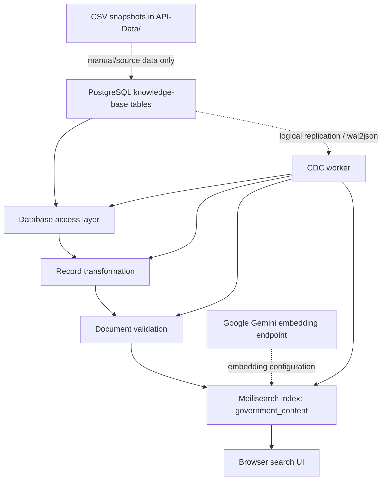

Government of Bermuda — Knowledge Base Search
A hybrid search experience for Government of Bermuda content, backed by Meilisearch and a PostgreSQL knowledge base. The repository contains a browser-based search interface, a Python ingestion and synchronization pipeline, Meilisearch index configuration, and a PostgreSQL logical-replication worker for keeping indexed content aligned with source records.
> **Repository status:** this README documents the files present in the supplied repository snapshot. A few integration/configuration gaps are listed under [Known gaps before running](#known-gaps-before-running); the repository should not be treated as a turnkey deployment until those are resolved.
Contents
Overview
Features
Architecture
Repository layout
Technology stack
Prerequisites
Configuration
Setup
Running the components
Data model and indexing
Search behavior
Operational checks
Known gaps before running
Security notes
Development and testing
License
Overview
The project brings four types of Government of Bermuda content into one searchable Meilisearch index:
Articles
News
Pages
Online services
The Python pipeline reads source rows from PostgreSQL, normalizes their content into a common document structure, validates required fields and vector dimensions, and writes documents to Meilisearch. The index is configured for both text matching and semantic retrieval. A standalone HTML/CSS/JavaScript interface sends search requests directly to the Meilisearch HTTP API.
The `API-Data/` directory also contains CSV snapshots for the four content groups. The ingestion implementation currently reads PostgreSQL tables; it does not automatically load those CSV files into PostgreSQL.
Features
Unified content index for articles, news, pages, and services.
Hybrid search configuration with a default semantic ratio of `0.70` (70% semantic, 30% keyword) in the browser search request.
Semantic embeddings configured through Meilisearch's REST embedder integration with Google's `gemini-embedding-001` model.
Autocomplete suggestions based on title-only search, with up to five suggestions.
Search result pagination with a page size of 20.
Content normalization including HTML-to-text conversion, whitespace cleanup, topic normalization, and a consolidated `search_text` field.
Batch synchronization from PostgreSQL to Meilisearch, with optional clearing of the existing index and a final document-count check.
Document validation for IDs, titles, searchable text, topics, and embedding dimensions/values.
Change Data Capture (CDC) worker using PostgreSQL logical replication and `wal2json` to process inserts, updates, and deletes.
Docker Compose configuration for PostgreSQL and Meilisearch services.
Utility scripts for synchronization, CDC startup, and health checks.
Architecture

Full synchronization
Connect to PostgreSQL and check database availability.
Check Meilisearch availability and apply index settings.
Read supported source tables in batches.
Convert each row into the common search-document schema.
Validate the documents and submit each batch to Meilisearch.
Compare the indexed document count with the number of source records processed.
Incremental synchronization (CDC)
The CDC worker consumes logical-replication messages from PostgreSQL. For inserts and updates, it extracts the changed row ID, re-reads the authoritative row from PostgreSQL, transforms and validates it, then upserts it into Meilisearch. For deletes, it removes the corresponding search document. The worker acknowledges a replication message only after its processing path completes successfully.
Repository layout
```text
meilisearch-kb/
├── API-Data/
│   ├── articles_kb.csv       # Article data snapshot
│   ├── news_kb.csv           # News data snapshot
│   ├── pages_kb.csv          # Page data snapshot
│   └── services_kb.csv       # Service data snapshot
├── config/
│   └── settings.py           # Pydantic application/environment settings
├── docker/
│   ├── compose.yaml          # PostgreSQL + Meilisearch services
│   └── postgres/
│       └── Dockerfile        # PostgreSQL image with pgvector and wal2json
├── ingestion/
│   ├── cdc.py                # PostgreSQL logical replication consumer
│   ├── database.py           # PostgreSQL access and row normalization
│   ├── extract.py            # Typed source-record extraction layer
│   ├── meilisearch_client.py # Meilisearch operations and index tasks
│   ├── sync.py               # Full synchronization orchestration
│   ├── transform.py          # Shared document/content transformation
│   └── validate.py           # Search document validation
├── meili_config/
│   └── index_config.py       # Searchable/filterable fields and embedder
├── scripts/
│   ├── cdc.py                # CDC worker entry point
│   ├── health_check.py       # Database and Meilisearch health helpers
│   ├── sync.py               # CLI for full synchronization
│   └── validate_api.py       # HTTP checks for an expected API service
├── ui/
│   └── index.html            # Standalone browser search interface
├── .env.example              # Environment-variable template
├── .gitignore
└── requirements.txt          # Python dependencies
```
> The supplied archive also contains a local `venv/` and Python cache files. These are environment artifacts, not application source, and should not be committed to Git.
Technology stack
Area	Technology
Search engine	Meilisearch
Source database	PostgreSQL
Incremental change stream	PostgreSQL logical replication + `wal2json`
Embeddings	Google Gemini Embeddings (`gemini-embedding-001`) through Meilisearch's REST embedder configuration
Python configuration	Pydantic Settings and `python-dotenv`
Database access	Psycopg 3, Psycopg 2 replication support, SQLAlchemy dependencies
Transformation	Python, Beautiful Soup, Pandas, NumPy dependencies
Search client	Meilisearch Python SDK and HTTPX
Front end	HTML, CSS, vanilla JavaScript
Container orchestration	Docker Compose
Prerequisites
Python 3.10+ (the archive includes a Python 3.13 virtual environment, but a local environment should be created for your own OS and Python version).
Docker Engine/Desktop and Docker Compose, if running the containerized services.
A PostgreSQL database with the expected knowledge-base schema and source tables.
A running Meilisearch instance.
A Google Gemini API key for the configured embedding endpoint.
A Meilisearch search-only key for the browser UI. Never expose a master/admin key in browser code.
Configuration
Create your local environment file from the template:
```bash
   cp .env.example .env
   ```
On PowerShell:
```powershell
   Copy-Item .env.example .env
   ```
Set the required values in `.env`. The main settings currently used by the Python modules are:
Variable	Purpose	Example/default
`APP_NAME`	Application label	`Government Knowledge Base Search`
`APP_ENV`	Runtime environment label	`development`
`LOG_LEVEL`	Logging verbosity	`INFO`
`DB_HOST`	PostgreSQL host	`localhost`
`DB_PORT`	PostgreSQL port	`5432`
`DB_NAME`	PostgreSQL database	`API-Data`
`DB_USER` / `DB_PASSWORD`	Database credentials	Set locally
`KB_SCHEMA`	Schema containing source tables	`public`
`MEILI_HOST`	Meilisearch base URL	`http://localhost:7700`
`MEILI_MASTER_KEY`	Server-side Meilisearch key for ingestion/admin operations	Set locally; never expose in the UI
`MEILI_INDEX_NAME`	Target index name	`government_content`
`MEILI_TIMEOUT_SECONDS`	Meilisearch HTTP timeout	`30`
`GEMINI_API_KEY`	Credential for Gemini embeddings	Set locally
`EMBEDDING_MODEL`	Embedding model identifier	`gemini-embedding-001`
`EMBEDDING_DIMENSIONS`	Expected vector size	`3072`
`INGESTION_BATCH_SIZE`	Number of documents per batch	`100`
`.env.example` also includes `MEILI_SEARCH_KEY` for the browser interface. The current HTML file has its own embedded search-key constant; move that configuration out of the source file and inject a restricted search-only key through a safe deployment mechanism before publishing or deploying the UI.
The CDC implementation additionally expects `CDC_SLOT_NAME` and `CDC_PLUGIN` settings, while table iteration expects an excluded-table setting. These are referenced by the code but are not currently declared in `config/settings.py`; see Known gaps before running.
Setup
From the repository root, create and activate a virtual environment.
Windows PowerShell
```powershell
py -m venv .venv
.\.venv\Scripts\Activate.ps1
python -m pip install --upgrade pip
pip install -r requirements.txt
```
If PowerShell blocks activation, use Command Prompt activation instead:
```bat
.venv\Scripts\activate.bat
```
macOS / Linux
```bash
python3 -m venv .venv
source .venv/bin/activate
python -m pip install --upgrade pip
pip install -r requirements.txt
```
Configure `.env`, then ensure the PostgreSQL source tables and Meilisearch instance are available. The source tables expected by the implementation are:
`public.articles_kb`
`public.news_kb`
`public.pages_kb`
`public.services_kb`
The code assumes the tables have an `id` column and the content fields referenced in `ingestion/transform.py`. Existing embeddings are read from the PostgreSQL `embedding` column; the extractor does not generate embeddings itself.
Running the components
Full synchronization
After the configuration gaps below have been resolved and both services are reachable:
```bash
python -m scripts.sync
```
To delete all existing documents in the configured Meilisearch index before synchronizing:
```bash
python -m scripts.sync --clear
```
> **Caution:** `--clear` deletes all documents in the target index before repopulating it. Confirm the host and index before using it against shared or production infrastructure.
CDC worker
After PostgreSQL logical replication is enabled, the `wal2json` output plugin is installed, the replication user has the necessary permissions, and the missing CDC settings are defined:
```bash
python -m scripts.cdc
```
The worker is designed to keep running and retry after exceptions. Run it under a process supervisor for a long-lived deployment and monitor its logs and replication-slot/WAL retention.
Browser search interface
The UI is a standalone file and does not require a JavaScript build step. Open `ui/index.html` in a browser or serve the repository with a static web server. For example, from the repository root:
```bash
python -m http.server 8080
```
Then open `http://localhost:8080/ui/`.
The page sends requests directly to `http://localhost:7700/indexes/government_content/search` by default. Adjust the host and index in the UI configuration if your deployment differs. Browser requests also require a valid search-only key and appropriate Meilisearch CORS configuration. Do not use a master key in client-side code.
Docker Compose
The supplied Compose file is located at `docker/compose.yaml`. Review it before running. It references a prebuilt image named `government-kb-postgres:16` and two externally named Docker volumes; those resources are not created by the Compose file itself. The sample database credentials are for local development only and must be replaced for any shared environment.
Data model and indexing
The index name defaults to `government_content`. Each source record is transformed into a unified document containing fields such as:
`id` — source-table-qualified ID, intended to avoid collisions across source tables.
`source_id` — original source record ID.
`source_table` and `content_type` — record provenance/type.
`title`, `summary`, and `content` — normalized text content.
`agency_name`, `topics`, `published_at`, `url`, and `form_url` — metadata used for retrieval and display.
`search_text` — consolidated text assembled from title, summary, content, agency, and topics.
`_vectors.default` — existing vector read from PostgreSQL and passed to Meilisearch.
The index configuration makes title, summary, content, agency, topics, and `search_text` searchable. It also configures filtering by content type, source table, agency, topics, and publication date, plus sorting by publication date. Typo tolerance is enabled.
The transformer uses `body_html` for article/news/service content and `content` for page records. HTML content is converted to plain text before indexing.
Search behavior
The UI currently configures:
Hybrid semantic ratio: `0.70`.
Result page size: `20`.
Autocomplete maximum: `5`.
Ranking score threshold: `0.84`.
Suggestions: title-only search.
These values are defined in `ui/index.html`; the backend index settings are in `meili_config/index_config.py`. Tune them against representative queries and relevance judgments before treating them as production-quality defaults. A semantic ratio or ranking threshold is not, by itself, evidence of search accuracy.
Operational checks
`scripts/health_check.py` provides helper functions to check PostgreSQL connectivity and Meilisearch health/document count. It currently defines functions rather than a command-line `main()` entry point.
`scripts/validate_api.py` is an HTTP smoke-test script for an API expected to run at `http://127.0.0.1:8000`. It checks `/health`, `/health/database`, `/health/search`, and a keyword `/search` request. A FastAPI application implementing those endpoints is not present in this archive, so this script cannot pass unless that API is supplied separately.
Known gaps before running
The following issues were identified while reviewing the supplied files. Resolve them before relying on the commands above:
Missing settings referenced by the code. `config/settings.py` defines an `excluded_kb_tables` property that references `kb_excluded_tables`, but the underlying setting is not declared. The CDC module also references `cdc_slot_name` and `cdc_plugin`, which are not declared in the settings model or `.env.example`. Table iteration and CDC startup can therefore fail until these settings are added or the code is updated.
The API smoke test has no matching API implementation in this repository snapshot. `scripts/validate_api.py` expects a running HTTP API on port 8000, but no FastAPI application or route definitions are included.
The browser search key is embedded in `ui/index.html`. Treat it as exposed. Rotate it if it is a real key, replace it with a restricted search-only key, and remove credentials from tracked source. Never place `MEILI_MASTER_KEY` in the browser.
Compose prerequisites are external. `docker/compose.yaml` references an image and named external volumes that must already exist. It also has a database-name inconsistency: `POSTGRES_DB` is set to `gob_assistant`, while the health check probes `API-Data`. Align the database name and health check before starting the stack.
CSV snapshots are not loaded by the current ingestion code. If these files are the intended source for a fresh installation, add and document a CSV-to-PostgreSQL import step, or use a database that already contains the expected tables.
Full-sync count verification assumes an index dedicated to this data. The final count is compared with the number of source rows processed. If the index contains unrelated documents or excluded tables are configured, this check may fail unless the synchronization strategy is adjusted.
No automated test suite is included in the supplied source tree. `pytest` appears in the dependencies, but no test files were found in the archive.
Security notes
Keep `.env` out of version control. Commit only `.env.example` with placeholders.
If a credential has ever been committed, embedded in the HTML, or shared in an archive, rotate it; deleting it from the latest version alone does not revoke it.
Use a restricted Meilisearch search-only key in browser requests. Keep the master key server-side.
Replace sample Docker/database credentials and restrict exposed service ports outside local development.
Do not publish the full `API-Data/` snapshots unless you have confirmed that redistribution is permitted and that the data contains no restricted information. The files are large (the news snapshot alone is hundreds of megabytes); consider documenting a download/import process instead of committing large datasets.
Keep virtual environments, generated caches, logs, and local data out of Git.
Development and testing
Install dependencies using the steps above. After resolving the configuration and integration gaps, validate the pipeline in stages:
Confirm PostgreSQL connectivity and inspect the four source tables.
Confirm Meilisearch health and verify the configured index settings.
Test transformation and validation with representative rows from each source table.
Run a small synchronization in a non-production index and check the indexed document count.
Test keyword and hybrid queries against a curated set of expected results.
Test CDC insert, update, and delete events, including reconnect/replay behavior.
Add automated unit and integration tests for transformation, validation, database access, Meilisearch operations, and CDC event parsing.
License
No license file was present in the supplied repository snapshot. Add a `LICENSE` file before presenting the project as open source, and ensure you have permission to redistribute the source data and any included assets.
